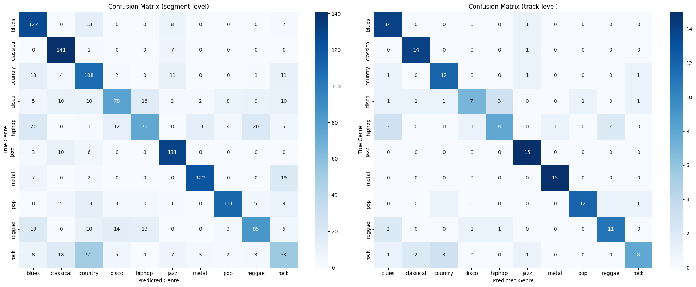

# Music Genre Classification with a 2D CNN

A 2D convolutional neural network that classifies music into 10 genres from log-mel spectrograms, trained on GTZAN with a track-level train/validation/test split and tested on 50 commercial songs.

Erasmus+ mobility project, University of Alcalá, 2026.

## Results

All numbers come from one top-to-bottom run of [`notebooks/genre_classification.ipynb`](notebooks/genre_classification.ipynb) (Colab, T4 GPU). The test tracks were used once, after all model selection was finished.

| Evaluation | Unit | Accuracy |
|---|---|---|
| GTZAN test set, segment level | 1,499 segments of 3 s | **68.8%** |
| GTZAN test set, track level (soft voting) | 150 tracks of 30 s | **77.3%** |
| Real-world songs (soft voting) | 50 commercial songs | **58.0%** (29/50) |

Chance level is 10%. Track-level accuracy averages the predicted probabilities of a track's ten 3 s segments, the same rule used for the real songs, so those two numbers are the ones to compare. With 150 test tracks and 50 songs, the 95% confidence intervals are roughly ±7 and ±14 percentage points.



Rock is the weakest GTZAN class (segment F1 0.40, often confused with country), while classical, jazz and metal are the strongest (F1 0.83 to 0.84). On real songs the model gets all classical and disco songs right, but only 1 of 5 pop and 1 of 5 metal songs; most metal songs are predicted as rock.

## Approach

1. **Data.** GTZAN (Tzanetakis & Cook, 2002): 1,000 clips of 30 s, 10 genres. `jazz.00054` is excluded because it is corrupted in the commonly distributed Kaggle copy, leaving 999 tracks.
2. **Split.** Tracks are split 70/15/15 into train, validation and test (699/150/150), stratified by genre, seed 42, before segmentation. All segments of a track stay in the same split, so the model is never tested on parts of a song it was trained on.
3. **Features.** Each track is cut into ten 3 s segments, and each segment becomes a 128-band log-mel spectrogram (`n_fft=2048`, 22,050 Hz).
4. **Model search.** A keras-tuner random search with 20 trials per hop length (512 and 256), up to 30 epochs with early stopping. It searches the number of conv blocks (2 or 3), filters per block, dense units, dropout and learning rate. Everything is selected on **validation accuracy only**.
5. **Final model.** It is rebuilt from the saved `best_config.json` by the same `build_cnn` function the search used, trained on the training tracks, and evaluated once on the test tracks.
6. **Real-world test.** Each full song is cut into 3 s segments, and the segment probabilities are averaged (soft voting).

Selected configuration (validation accuracy 76.9% at hop 512 vs 74.1% at hop 256):

| hop length | conv blocks | filters | dense units | dropout | learning rate |
|---|---|---|---|---|---|
| 512 (128 × 130 input) | 3 | 32, 64, 32 | 64 | 0.5 | 1e-3 |

## Real-world test: 50 songs

<details>
<summary>All 50 songs with predictions (song titles only; the audio is not included)</summary>

| True genre | Song | Predicted | Probability |
|---|---|---|---|
| blues | B.B. King – The Thrill Is Gone | blues ✓ | 30.3% |
| blues | John Lee Hooker – Boom Boom | jazz | 27.3% |
| blues | Muddy Waters – Hoochie Coochie Man | blues ✓ | 64.8% |
| blues | T-Bone Walker – Stormy Monday Blues | country | 27.3% |
| blues | The Blues Brothers – Sweet Home Chicago | country | 34.9% |
| classical | Jairos – Moonlight Sonata | classical ✓ | 41.3% |
| classical | Kiri Te Kanawa – O Mio Babbino Caro | classical ✓ | 85.1% |
| classical | Ludwig van Beethoven – Für Elise | classical ✓ | 56.6% |
| classical | Ludwig van Beethoven – Ode to Joy | classical ✓ | 93.1% |
| classical | Martin Jones – Clair de Lune, L. 32 | classical ✓ | 96.7% |
| country | Garth Brooks Tribute – Friends in Low Places | country ✓ | 59.3% |
| country | George Jones – He Stopped Loving Her Today | classical | 37.1% |
| country | Johnny Cash – Ring of Fire | jazz | 37.8% |
| country | Patsy Cline – Crazy | jazz | 38.2% |
| country | Tammy Wynette – Stand By Your Man | country ✓ | 53.1% |
| disco | Bee Gees – Stayin' Alive | disco ✓ | 75.9% |
| disco | Chic – Le Freak | disco ✓ | 32.8% |
| disco | Donna Summer – I Feel Love | disco ✓ | 77.8% |
| disco | Dua Lipa – Don't Start Now | disco ✓ | 47.1% |
| disco | Earth, Wind & Fire – Boogie Wonderland | disco ✓ | 45.6% |
| hiphop | 2Pac – California Love | hiphop ✓ | 32.2% |
| hiphop | 50 Cent – In Da Club | hiphop ✓ | 37.4% |
| hiphop | Kendrick Lamar – Not Like Us | hiphop ✓ | 62.4% |
| hiphop | N.W.A – Straight Outta Compton | hiphop ✓ | 72.7% |
| hiphop | The Notorious B.I.G. – Juicy | disco | 36.7% |
| jazz | Frank Sinatra – Fly Me To The Moon | blues | 49.9% |
| jazz | Louis Armstrong – What a Wonderful World | classical | 66.4% |
| jazz | Miles Davis – So What | jazz ✓ | 85.9% |
| jazz | Stan Getz – The Girl From Ipanema | blues | 38.3% |
| jazz | The Dave Brubeck Quartet – Take Five | jazz ✓ | 72.8% |
| metal | Black Sabbath – Iron Man | rock | 47.1% |
| metal | Black Sabbath – Paranoid | hiphop | 27.3% |
| metal | Iron Maiden – The Trooper | rock | 70.6% |
| metal | Metallica – Master Of Puppets | metal ✓ | 71.9% |
| metal | Motörhead – Ace of Spades | rock | 69.1% |
| pop | Lady Gaga – Die With A Smile | country | 26.8% |
| pop | Olivia Rodrigo – stupid song | jazz | 20.8% |
| pop | Sabrina Carpenter – Espresso | hiphop | 22.1% |
| pop | Taylor Swift – I Knew It, I Knew You | country | 32.4% |
| pop | The Weeknd – Blinding Lights | pop ✓ | 34.5% |
| reggae | Bob Marley & The Wailers – No Woman No Cry | reggae ✓ | 59.6% |
| reggae | Bob Marley & The Wailers – One Love / People Get Ready | reggae ✓ | 85.6% |
| reggae | Bob Marley & The Wailers – Three Little Birds | reggae ✓ | 77.9% |
| reggae | Desmond Dekker – Israelites | reggae ✓ | 45.4% |
| reggae | Jimmy Cliff – The Harder They Come | blues | 51.6% |
| rock | Fontaines D.C. – Starburster | rock ✓ | 31.3% |
| rock | Foo Fighters – Rescued | rock ✓ | 67.4% |
| rock | Led Zeppelin – Stairway To Heaven | country | 34.8% |
| rock | Måneskin – ZITTI E BUONI | rock ✓ | 34.9% |
| rock | The Black Keys – Wild Child | classical | 24.4% |

</details>

The genre labels of these songs are my own choice, and several are debatable (for example, Black Sabbath as metal rather than rock, or Dua Lipa as disco).

## How to run

### Google Colab (as used for the results)

1. Download GTZAN from [Kaggle](https://www.kaggle.com/datasets/andradaolteanu/gtzan-dataset-music-genre-classification), or use the original `.au` release, and zip it so that the archive contains `genres/<genre>/<files>`.
2. In Google Drive, create `MyDrive/SupervisedProject/` containing `dataset.zip` and, optionally, `test examples/<genre>/<songs>` for the real-world test.
3. Open `notebooks/genre_classification.ipynb` in Colab, choose a T4 GPU runtime, and run all cells. A full run takes about 2 hours. The tuner state is saved to Drive, so an interrupted run resumes.

### Locally

Requires Python 3.11 or newer (the results were produced with Python 3.12 on Colab).

```bash
git clone https://github.com/dominikgrc8/Music-Genre-Classification-2D-CNN.git
cd Music-Genre-Classification-2D-CNN
pip install -r requirements.txt
```

Put the data in `data/genres/<genre>/` (ignored by git). Then:

```bash
python src/train.py --data-dir data/genres          # search, final model, test evaluation
python src/train.py --data-dir data/genres --config outputs/best_config.json   # skip the search
python src/predict.py --model outputs/final_model.keras --config outputs/best_config.json song.mp3
python src/predict.py --model outputs/final_model.keras --config outputs/best_config.json --eval-dir "test examples"
```

The notebook can also run locally (set `DATA_DIR`, `SONGS_DIR` or `PROJECT_DIR` if your paths differ). Note that TensorFlow has no native GPU support on Windows; use Colab, Linux or WSL2 for training.

## Repository structure

```
notebooks/genre_classification.ipynb   full pipeline with outputs of the reported run
src/features.py                        track listing, track-level split, log-mel segments
src/model.py                           CNN shared by the search and the final model
src/train.py                           search -> best_config.json -> final model -> test
src/predict.py                         soft-voting prediction for full songs
reports/report.pdf                     mobility project report
reports/seminar_audio_ml_hr.pdf        background seminar (Croatian)
reports/figures/                       confusion matrix, example spectrogram
```

## Limitations

- **GTZAN has known faults:** repeated clips, mislabelled tracks and many clips from the same artists (Sturm, 2013). The split is by track, not by artist, so artist overlap between train and test can still inflate the GTZAN numbers.
- **The test sets are small:** 150 GTZAN test tracks and 50 real songs (5 per genre). One song changes a genre's real-world accuracy by 20 percentage points.
- **The search is limited:** a random search of 20 configurations per hop length, from a single run with one seed. Seeds are fixed, but GPU training is not bit-for-bit deterministic, so a rerun can differ slightly.
- **There is a domain gap:** GTZAN clips are mostly older recordings (collected around 2000) of 30 s. Modern productions, especially pop, are classified much worse.

## Background

This project builds on my seminar "Evolucija metoda strojnog učenja u analizi audio signala" (The evolution of machine learning methods in audio signal analysis), [`reports/seminar_audio_ml_hr.pdf`](reports/seminar_audio_ml_hr.pdf), **written in Croatian**. It traces how audio classification moved from hand-crafted features to learned representations:
- **Hand-crafted features:** MFCCs fed to statistical and discriminative models such as Gaussian mixture models, hidden Markov models and support vector machines.
- **CNNs on (mel) spectrograms:** they treat audio as an image and learn features directly, followed by large pretrained audio networks such as VGGish (Hershey et al., 2017) and PANNs (Kong et al., 2020), used as general-purpose feature extractors.
- **The Audio Spectrogram Transformer** (Gong et al., 2021): a convolution-free model built on the Vision Transformer encoder that splits the spectrogram into patches and uses self-attention to model global context.

This project implements the CNN stage of that progression.

## References

- Gong, Y., Chung, Y.-A., & Glass, J. (2021). AST: Audio Spectrogram Transformer. *Proc. Interspeech 2021*, 571–575.
- Hershey, S., et al. (2017). CNN architectures for large-scale audio classification. *Proc. IEEE ICASSP 2017*, 131–135.
- Kong, Q., et al. (2020). PANNs: Large-scale pretrained audio neural networks for audio pattern recognition. *IEEE/ACM Transactions on Audio, Speech, and Language Processing*, 28, 2880–2894.
- Sturm, B. L. (2013). The GTZAN dataset: Its contents, its faults, their effects on evaluation, and its future use. arXiv:1306.1461.
- Tzanetakis, G., & Cook, P. (2002). Musical genre classification of audio signals. *IEEE Transactions on Speech and Audio Processing*, 10(5), 293–302.

## License

Code: [MIT](LICENSE). GTZAN and the commercial songs are not included in this repository and are subject to their own licenses.
